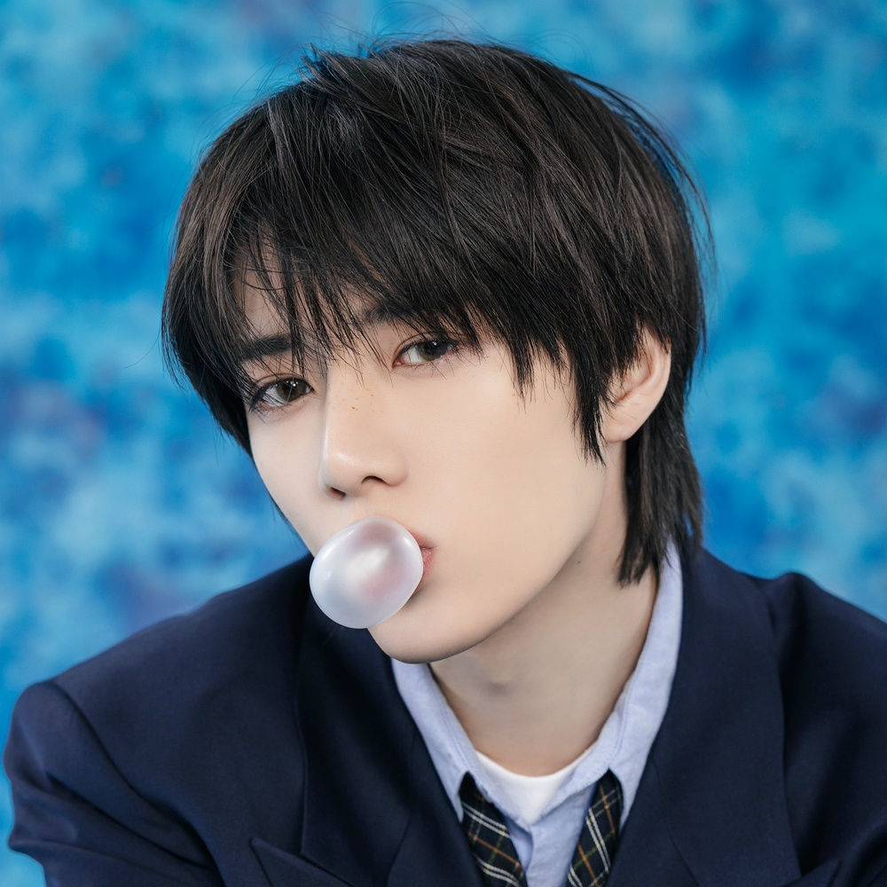
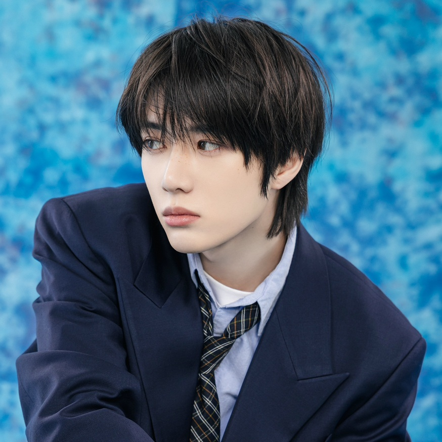

# What's up, rockstar? Welcome to my world! 
**@bnjoexe ;** hi, my name is Benjo. i use he/him pronouns, a '01 (March) liner, an isfj, and i'm from Manila, Philippines. i speak English and Filipino, and i'm a working student.

  
  
  

 

System.out.println("IT student by accident, " + "Rockstar by heart, " + "Full-time puyat.");

 

> **⚠️ DISCLAIMER:** 
> This is a **fictional character / roleplay account** created purely for creative writing and storytelling purposes. All events, campus rants, and interactions are part of a shared OC universe. Not affiliated with Choi Beomgyu or TOMORROW X TOGETHER or real-life individuals and institutions in any way.
>
> All photos used on this account do not belong to the handler unless stated otherwise. Credits go to the respective owners. If you own any of the media posted and would like it removed, please drop a message on discord.

---

### The Character;
Benjo is a laid-back yet ambitious third-year IT student majoring in Software Development at Mapúa University, navigating the chaos of college life, major projects, questionable group decisions, and the occasional existential crisis. He's the type to bullshit his way through deadlines, life choices, and those cursed worksheets while pretending he's got everything under control.

A former band guitarist who hit pause to focus on school, reality, and everything in between. Music, though, never really left him. It's still his safest space, something he turns to when life gets a little too loud.

A firm believer that dark mode is superior and that everything in life can (eventually) be automated—except his sleep schedule. Benjo gravitates toward anything that involves making systems easier and more intuitive to use. He's particularly interested in the little details people tend to overlook: inefficient workflows, confusing interfaces, unnecessary steps, and features that could've been designed better.

Through his exposure to GUI development, prototyping, and QA testing, he's developed an eye for identifying problems, validating functionality, and questioning whether something actually works as intended. He'd rather spend his time refining an interface and testing a system than figuring out why a connection isn't working, but that doesn't mean he shies away from technical challenges. 

He lives in hoodies, sweatshirts, and bomber jackets. Headphones are almost always on, and the guitar pick keychain from his dad doubles as his emotional support fidget.

A professional procrastinator with a sharp tongue. Heavy on sarcasm, heavier on profanities. He stays soft-spoken until provoked, and has a complicated relationship with attention: hates being ignored, hates being overhyped. He mirrors energy. Sometimes he matches it. Sometimes he amplifies it. Sometimes he burns it down.

Not that he has favorites, but there are people he listens to a little more than he'd like to admit. He'd rather joke his way out of an awkward situation than openly admit what's going on.

At least the deadlines are keeping him humble.

---

### Content and Storytelling;
This account leans heavily into storytelling. Expect long posts, ongoing arcs, and occasional rambling. If that’s not your thing, add at your own risk—this isn’t everyone’s cup of tea.

Most posts are part of continuous arcs with the friend group ([Zildj](https://www.facebook.com/share/p/1A1FLFfnbP/), [Max](https://www.facebook.com/share/p/1fEBx3BPGB/), [Jace](https://www.facebook.com/share/p/1JDVqZeL2G/), and Kai) and University friends ([Andrea](https://www.facebook.com/profile.php?id=61596268391355), Stephanie, Aldrin, and Joferson).

Collabs and plotting are welcome. Hit me up on Discord.

---

### Compatibility Check;
Benjo’s handler is Filipino, of legal age, and usually busy. Replies may take time or may not come at all. `Not active on Messenger`.

I’m not great at initiating interactions. I tend to engage more with people who actually engage with me.

`Monthly digital hygiene:` I unfriend deactivated and inactive users (30+ days) or those I’ve never interacted with. Exceptions apply. Don’t take it personally. Or do. I don’t care. Feel free to do the same if I’m the inactive one.

I only accept OC accounts. Preferably with an intro, I like knowing who I’m welcoming to my little world.

`I READ UPDATES` like a show I’m invested in. I may be a silent reader, but you’ll probably catch me reacting.

English/Filipino/Taglish are the languages used for updates and interactions. If that’s not something you’re comfortable with, this might not be the account for you.

Strictly OC. Let’s keep everything in character.

---

  est. 2025.02.27 • last updated 2026.11.16

